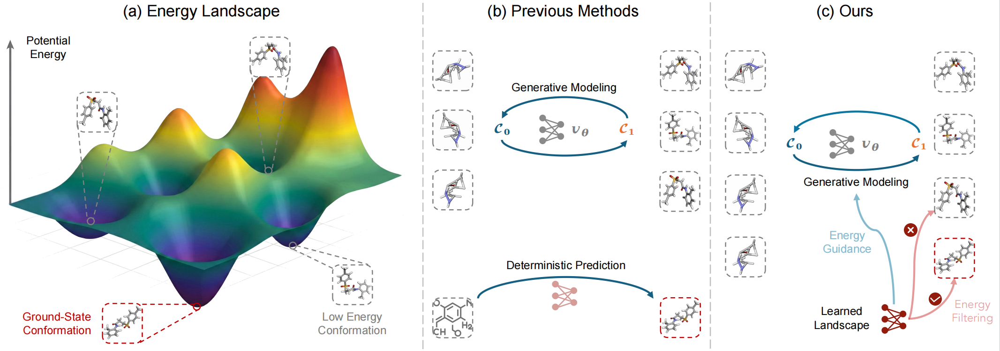
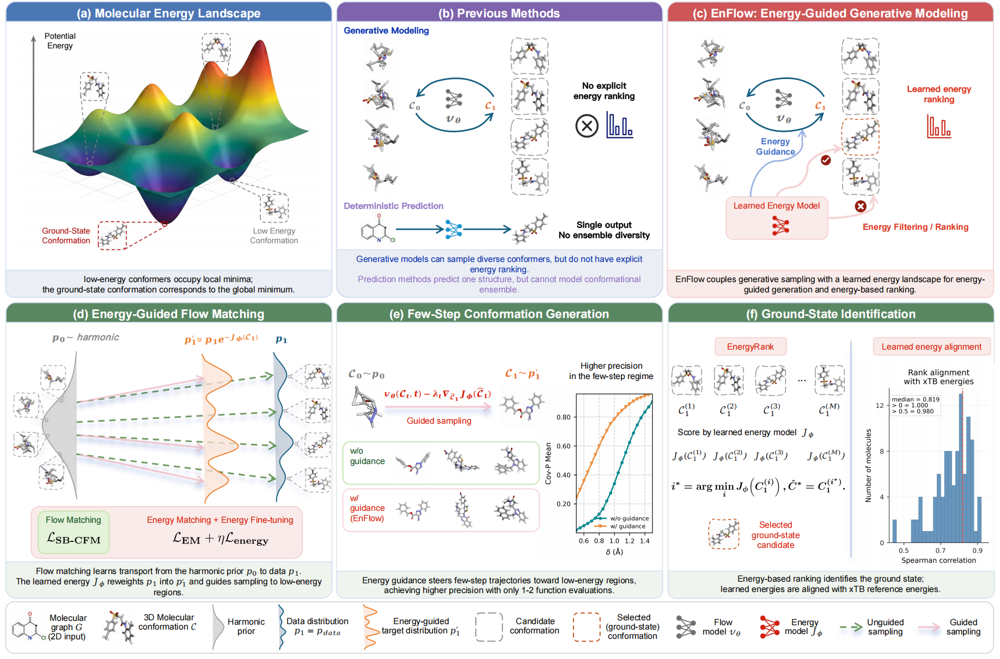

<div align="center">

# EnFlow: Energy-Guided Generative Modeling for Low-Energy Molecular Structure Discovery

<a href="https://pytorch.org/get-started/locally/"></a>
<a href="https://pytorchlightning.ai/"></a>

</div>


The official implementation of the manuscript **"Energy-Guided Generative Modeling for Low-Energy Molecular Structure Discovery"** 

<h4 align="center">Abstract</h4>

<div align="justify">
Exploring molecular energy landscapes and identifying ground-state conformations are central challenges in computational chemistry. However, generating diverse low-energy conformers from molecular graphs remains expensive with traditional physics-based pipelines. Existing learning-based approaches remain fragmented: generative models capture conformational diversity but often lack reliable energy calibration, whereas deterministic predictors focus on a single structure and fail to represent ensemble variability. Here we introduce EnFlow, to our knowledge, the first energy-guided generative framework that couples flow-based conformer generation with explicit energy landscape modeling for joint conformational ensemble generation and ground-state identification. By integrating generative dynamics with a learned energy model, EnFlow guides sampling toward low energy regions of the conformational landscape, improving structural fidelity under extremely few sampling steps while enabling energy-based ranking of generated conformations. Experiments on GEOM-QM9 and GEOM-Drugs show that EnFlow achieves strong performance in conformer generation and ground-state identification while requiring only 1--2 ODE sampling steps. Single-point GFN2-xTB evaluations further show that the learned energy scores preserve physically meaningful energetic rankings of generated conformations. These results support explicit energy landscape modeling as an effective strategy for low-energy molecular structure discovery through joint modeling of conformational ensembles and their associated energies.
</div>


<h4 align="center">Overview</h4>

<p align="center">
  <!--  -->
  
</p>

------

### Setup Dev Environment

Run the following commands to setup the environment:

```bash
conda env create -f env.yml -n enflow
conda activate enflow
# Install the package in editable mode (for development).
pip install -e .
```

------

### Preprocessing Data

To pre-process the data, perform the following steps,

1. Set up the environment variable `$DATA_DIR`,

      ```bash
      DATA_DIR=</path_to_data, e.g.,'~/Data/Geom'>
      ```

2. Download the **GEOM** datasets ( drugs.tar.gz and qm9.tar.gz ) prepared by [Torsional Diffusion](https://drive.google.com/drive/folders/1BBRpaAvvS2hTrH81mAE4WvyLIKMyhwN7) to `$DATA_DIR` and extract them. After extraction, `$DATA_DIR` should have the following directory structure,

      ```bash
      $DATA_DIR/
            ├── QM9/
            │   ├── qm9/
            │   │   ├── smiles.pickle
            │   │   └── ...
            │   ├── test_mols.pkl
            │   └── test_smiles.csv
            └── DRUGS/
            ├── drugs/
            │   ├── smiles.pickle
            │   └── ...
            ├── test_mols.pkl
            └── test_smiles.csv
      ```

3. Run the following commands to prepare the GEOM dataset for EnFlow training. All preprocessed data will be created inside path `$DATA_DIR/processed/`,

      ```bash
      python scripts/prepare_data.py
      ```

4. (Optional) As described in our manuscript, we apply the $\textit{Reflow}$ technique to obtain more aggressive one-step generation results. This step is performed after the main training process. First, we use well-trained checkpoints to generate sample pairs $(x_0, x_1')$ for $\textit{Reflow}$ training. This process produces pair data, which will be saved to `$DATA_DIR/reflow_processed/`.

      ```bash
      python scripts/gen_reflow_pairs.py \
      --config configs/EM2-qm9-so3.yaml \
      --checkpoint <checkpoint-path> \
      --num_reflow_pairs 64 \
      --num_ode_steps 50
      ```

------

### Training
We provide various configuration files in `./configs` for training on the **GEOM-Drugs** and **GEOM-QM9** datasets. As described in our manuscript, the training process consists of the following phases:

1. **Matching phase**, which performs the main training with $\textit{Flow Matching}$ and $\textit{Energy Matching}$ objectives, 

      ```bash
      python scripts/train.py -c configs/EM1-qm9-so3.yaml
      ```

2. **Energy fine-tuning phase**, which further fine-tunes the energy model to better align with the true energy distribution. Note that the `pretrained_ckpt` field in the configuration file should be set to the path of the final checkpoint obtained from the previous phase:

      ```bash
      python scripts/train.py -c configs/EM2-qm9-so3.yaml
      ```

3. **(Optional) Reflow training**, which enables more aggressive one-step generation. First, prepare the $\textit{Reflow}$ training data as described above, then set the `pretrained_ckpt` field in the configuration file to the path of the final checkpoint from the previous phase:

      ```bash
      python scripts/train.py -c configs/Reflow-qm9-so3.yaml
      ```

------

### Evaluation on Different Tasks

For the **Molecular Conformation Generation** task, evaluation happens in 2 steps as follows,

1. **Generating Conformations**. To run the evaluation on either GEOM or QM9 given a config and a checkpoint, run the following command,
      ```bash
      python scripts/eval_multi_gpu.py \
      --config=<config-path> \
      --checkpoint=<checkpoint-path> \
      --energy_guided
      -guide_scale 4
      --return_energy 
      ```

      - `--energy_guided`: enable the energy-guided sampling scheme.
      - `--guide_scale`: guidance strength for energy guidance (e.g., 4 corresponds to $\lambda_t = 0.4 \cdot (1 - t)^2)$.
      - `--return_energy`: return the predicted energy from the energy model.
      - The number of ODE sampling steps is specified in the configuration file at <config-path>.

2. **Evaluating Conformations** with Cov and AMR Metrics. The above sample generation script should created a `generated_files.pkl` at the following path, `logs/samples/<config-path>/<data-time>/generated_files.pkl`. With the given path, we can get the various  metrics using,

      ```bash
      python scripts/eval_cov_mat.py --path=<path-to-generated-files.pkl> --num_workers=10
      ```

For the **Molecular Ground-state Conformation prediction** task, evaluation happens in 2 steps as follows,

1. **Generating Conformations**. To run the evaluation on either GEOM or QM9 given a config and a checkpoint, run the following command,

      ```bash
      python scripts/eval_multi_gpu_lowest_energy.py \
      --config=<config-path> \
      --checkpoint=<checkpoint-path> \
      --guide_scale \
      --return_energy \ 
      --num_samples 5 \
      ```

      - `--num_sample`: for each molecule, generate n samples for energy ranking. If $n \geq 2$, the $\texttt{EnsembleCert}$ (Alg. 3) mode is used for ground-state certification; if $n = 1$, the $\texttt{JustFM}$ (Alg. 3) mode is used to refine a generated conformation.

2. **Evaluating Conformations** with Distance and Coordinates Error Metrics. The above sample generation script should created a `generated_files.pkl` at the following path, `logs/samples/<config-path>/<data-time>/generated_files.pkl`. With the given path, we can get the various  metrics using,

      ```bash
      python scripts/eval_groundstate.py --path=<path-to-generated-files.pkl>
      ```

------

### Loading a Pre-Trained Checkpoint

Coming Soon!

------

### Acknowledgements
Our codebase is built using the following open-source contributions,
- [torchmd-net](https://github.com/torchmd/torchmd-net)
- [e3-diffusion-for-molecules](https://github.com/ehoogeboom/e3_diffusion_for_molecules)
- [pytorch lightning](https://lightning.ai/pytorch-lightning)
- [etflow](https://github.com/shenoynikhil/ETFlow.git)

------

### Contact
For further questions, feel free to raise an issue.

------

### Citation

If you find this repository useful, please consider citing our unpublished manuscript:

```
@article{xu2025energy,
  title={Energy-Guided Flow Matching Enables Few-Step Conformer Generation and Ground-State Identification},
  author={Xu, Guikun and Yi, Xiaohan and Zhao, Peilin and Bian, Yatao},
  journal={arXiv preprint arXiv:2512.22597},
  year={2025}
}
```

```
@misc{hassan2024etflow,
      title={ET-Flow: Equivariant Flow-Matching for Molecular Conformer Generation},
      author={Majdi Hassan and Nikhil Shenoy and Jungyoon Lee and Hannes Stark and Stephan Thaler and Dominique Beaini},
      year={2024},
      eprint={2410.22388},
      archivePrefix={arXiv},
      primaryClass={q-bio.QM},
      url={https://arxiv.org/abs/2410.22388},
}
```

------
